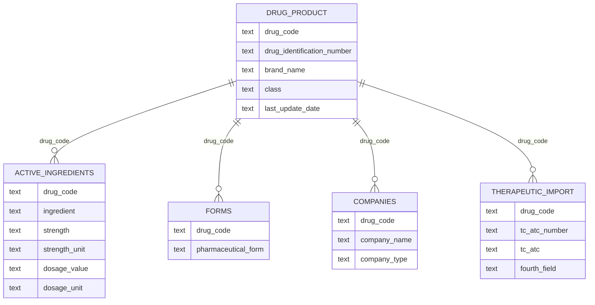

# Data dictionary and relationships

The original Health Canada extract uses flat files connected through `drug_code`. This diagram shows the relationships used by this project, **not** enforced PostgreSQL primary or foreign keys. `SELECT DISTINCT *` removes exact duplicate rows; it does not establish a unique key.

The connector from product to ingredient/form/company/class is a working relationship; actual optionality and uniqueness should be checked against each extract. A product can have several ingredients, forms or related company records. The ingredient-pair analysis counts products rather than joined rows.

| Column | Meaning in this project |
| --- | --- |
| `drug_code` | Internal product identifier used to join records; stored as text. |
| `drug_identification_number` | DIN from the source, stored as text to preserve its formatting; distinct from `drug_code`. |
| `class` | Product class, e.g., Human, Veterinary or Disinfectant. `Human` is a source category, not a clinical-use or safety claim. |
| `ingredient` | English active-ingredient name as imported. Spelling, case and salts are not standardized in this project. |
| `strength`, `strength_unit` | Original text amount and unit. They must be considered together with form and dosage fields. |
| `strength_numeric` | A computed unconstrained numeric cast of `strength` in `clean.active_ingredients_numeric_strengths`. The original text remains available. |
| `dosage_value`, `dosage_unit` | Source fields providing dosage/denominator context where present; blanks require investigation. |
| `pharmaceutical_form` | Source-reported form, such as TABLET or SOLUTION. |
| `company_name`, `company_type` | Names and roles reported in the company table. Different names may not correspond to different companies; a product can have multiple company roles. |
| `last_update_date` | Imported as text in this project. A last-update snapshot is not a complete history of update events. |
| `fourth_field` | Name used in the author's four-column local therapeutic import. Its meaning and file layout remain to be verified against the specific source file. |

Health Canada's published schema currently lists seven therapeutic-class fields, whereas the author's local `ther.txt` examples contained four. Do not assume the fourth field's meaning or import a seven-column file into a four-column table without inspecting it. See the [official data structure](https://www.canada.ca/en/health-canada/services/drugs-health-products/drug-products/drug-product-database/read-file-drug-product-database-data-extract.html).
